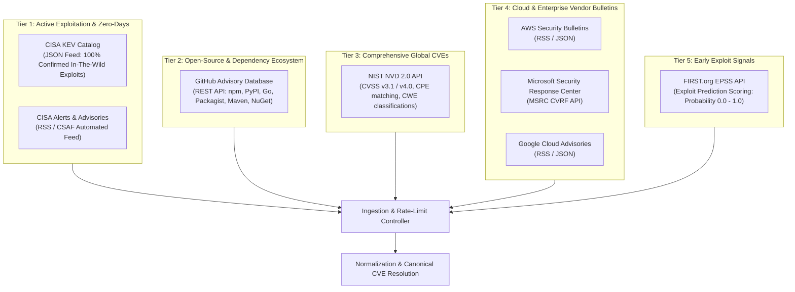
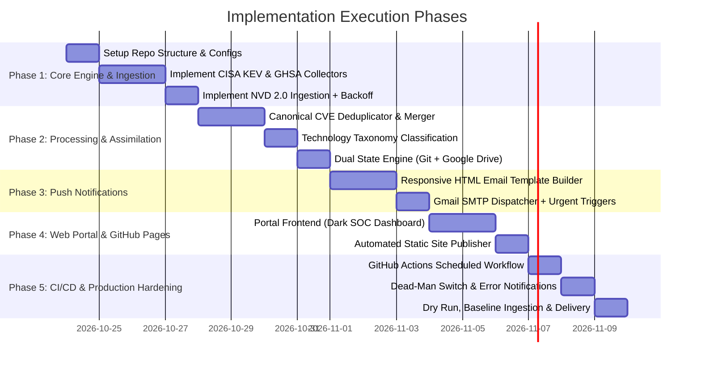

# Enterprise Implementation Plan: Proactive Multi-Source Cyber Threat Intelligence Monitor & Portal

**Document Version:** 1.0.0  
**Status:** Approved Architecture & Specification  
**Target Repository:** `global-security-monitor` (or `us-cyber-threat-update`)  
**Target Runtime:** GitHub Actions (Zero-cost Free Tier) + GitHub Pages Portal + Google Drive / Git State Engine  
**Author:** Pair Programming Agent (incorporating ChatGPT R&D and Enterprise Hardening Requirements)

---

## 1. Executive Summary & Vision

Modern threat landscapes require organizations and engineering teams to identify critical vulnerabilities and zero-days **before** they become mainstream news headlines. Relying on social media or delayed industry press is inherently reactive and leaves systems exposed during the critical window between vulnerability disclosure and active exploitation.

This project delivers a **production-grade, zero-cost, proactive Cyber Threat Intelligence (CTI) aggregation engine and notification pipeline**. The system operates continuously without dedicated servers (no AWS monthly bills, no always-on local machines), pulling from authoritative official sources, assimilating multi-source telemetry, classifying threats by technology and category, and pushing prioritized, executive-formatted alerts via email while maintaining a live, searchable web portal.

```
       OFFICIAL THREAT FEEDS                                 PROCESSING ENGINE                           CHANNELS & PORTAL
+-----------------------------------+             +-------------------------------------+             +-------------------------+
| - CISA KEV (Active Exploitation)  |             |          GITHUB ACTIONS             |             |  IMMEDIATE ALERT PUSH   |
| - NIST NVD 2.0 (CVSS / CPE)       |             |  (30-Min Cron / Free Runner)        |             |  - Gmail SMTP (HTML)    |
| - GitHub Advisory Database (GHSA) | ----------> |                                     | ----------> |  - CISA KEV / Critical  |
| - Vendor Bulletins (AWS, MSFT, GCP|             |  1. Ingestion & Resilient Backoff   |             +-------------------------+
| - Exploit Prediction (EPSS / CISA)|             |  2. Canonical CVE Assimilation      |                          |
+-----------------------------------+             |  3. Technology Taxonomy Tagging     |             +-------------------------+
                                                  |  4. State Tracking & Deduplication  | ----------> |  DAILY DIGEST (8 AM)    |
                                                  +-------------------------------------+             |  - Categorized Briefing |
                                                             |               |                        +-------------------------+
                                                             v               v                                     |
                                                  +--------------+    +-----------------+             +-------------------------+
                                                  | GOOGLE DRIVE |    | GITHUB PAGES    | ----------> |  LIVE WEB PORTAL        |
                                                  | / GIT STATE  |    | THREAT PORTAL   |             |  - Filter by Technology |
                                                  | (Persistence)|    | (Static JSON)   |             |  - Search & Metrics     |
                                                  +--------------+    +-----------------+             +-------------------------+
```

---

## 2. Requirements Verification & Gap Analysis

Below is an item-by-item verification comparing the user's requirements against the initial ChatGPT R&D thread and starter prototype:

| User Requirement Statement | Status in ChatGPT R&D | Audit Finding & Critical Gaps in ChatGPT Prototype | Enterprise Remediations in this Plan |
| :--- | :---: | :--- | :--- |
| **1. "Updated by technology and by category for any security alerts / threats."** | ⚠️ **Partial** | The chat discussed categories in text tables, but the Python code (`monitor.py`) **contained zero categorization or technology classification**. It output a flat, unorganized list of CVEs without technology tags. | Introduce a **Rules-Based & CPE Taxonomy Classifier** that tags every threat into standard categories (Cloud, Web, DB, OS, Networking, AI, AppSec) and specific tech stacks (AWS, Node.js, Next.js, PHP, PostgreSQL, Linux, Docker, Python). |
| **2. "We should not run the risk of waiting till it becomes the headlines. Proactive intervention as soon as it happens."** | ⚠️ **Partial** | Proposed a 30-min GitHub Actions cron, but relied heavily on NVD. NIST NVD has experienced documented multi-week analysis backlogs in 2024–2026. Waiting for NVD enrichment causes severe delays. | Ingest **CISA KEV** directly (instant publication of actively exploited bugs), **GitHub Advisories API** (real-time open-source zero-days), and **Vendor RSS/Atom Feeds** (AWS, Microsoft MSRC, Google Cloud) which publish hours/days ahead of NVD. |
| **3. "Need official sources. Multiple sources we need a way to source and aggregate / assimilate."** | ❌ **Failed in Code** | The starter script stored items as `KEV:CVE-...`, `GHSA:...`, `NVD:CVE-...`. A single CVE present in all three sources triggered **three duplicate entries** in the email instead of merging them. | Implement **Canonical Entity Resolution**: Merge multiple source records into a single canonical record keyed by `CVE-YYYY-XXXXX`, combining CISA's KEV exploitation status + NVD's CVSS score + GHSA's package patches + Vendor advisories. |
| **4. "Script can run on GitHub. Free GitHub can also run it without paid account."** | ✅ **Fulfilled** | Runs on GitHub Actions hosted runners (`ubuntu-latest`). Public repos have unlimited minutes; private repos have 2,000 free minutes/month. | Hardened runtime: optimize scan execution time to < 45 seconds (48 runs/day × 0.75 min × 30 days = ~1,080 minutes/month, well under the 2,000 free quota). |
| **5. "It can use Google Drive if any script has to be hosted there or any files have to be hosted there."** | ⚠️ **Omitted in Chat** | ChatGPT completely bypassed Google Drive and only used `git push` to commit `data/seen.json` directly to the repository default branch (creating ~1,440 commits/month). | Provide a dual-persistence engine: **Option A (Google Drive / Sheets API)** for clean decoupled storage, and **Option B (Dedicated Git Orphan Branch / GitHub Releases)** to prevent main-branch git commit pollution. |
| **6. "Requires multiple alternatives to be considered: different approaches."** | ⚠️ **Partial** | ChatGPT briefly mentioned AWS/local PC but defaulted immediately to GitHub Actions without a structured multi-criteria decision matrix. | Complete architectural comparison of **5 distinct deployment models** (GitHub Actions, AWS Serverless, Cloudflare Serverless Workers, Self-Hosted Container, and Hybrid). |
| **7. "Need a very robust solution not an experimental solution."** | ❌ **Fragile in Code** | ChatGPT's starter code lacked NVD rate-limit handling (NVD without API key rate-limits at 5 req / 30s), crashed on network timeouts, lacked graceful feed isolation, and had no circuit-breaker logic. | Production-grade resiliency: exponential backoff with jitter, optional NVD API Key support (increases limit to 50 req / 30s), per-source failure isolation, atomic state writes, and workflow failure alerts. |
| **8. "Push-based solution plus there can be a portal as well."** | ❌ **Omitted in Chat** | ChatGPT only implemented email sending. The portal requirement was completely skipped. | Implement an automated **GitHub Pages Threat Intelligence Portal** (zero maintenance, free static web application regenerated on every scan, filterable by technology and severity). |
| **9. "The push can come via email."** | ✅ **Fulfilled** | Implemented Gmail SMTP via App Password over port 587 with STARTTLS. | Retain Gmail SMTP support, with modular adapters for enterprise mail providers (Resend, SendGrid, Amazon SES) if volume increases. |
| **10. "The email formatting has to be improved."** | ❌ **Primitive in Code** | The generated email was an unstyled, raw HTML list (`<ol><li>...</li></ol>`) with no styling, no category grouping, and no visual hierarchy. | Design an **Executive-Ready, Mobile-Responsive HTML Email Template** with priority badges (CISA KEV, Critical CVSS), technology tags, "Why This Matters" summaries, and concrete remediation steps. |

---

## 3. Threat Intelligence Data Architecture

### 3.1 Official Authoritative Feeds

To guarantee zero latency and broad coverage across infrastructure, operating systems, cloud, and application layers, the system aggregates from six authoritative tiers:



#### Detailed Feed Specifications

1. **CISA Known Exploited Vulnerabilities (KEV) Catalog**
   - **URL:** `https://www.cisa.gov/sites/default/files/feeds/known_exploited_vulnerabilities.json`
   - **Characteristics:** Zero false positives. Every entry represents an actively exploited vulnerability observed in real-world attacks. CISA mandates federal remediation dates.
   - **Priority:** **Tier 1 - Immediate Urgent Dispatch** whenever a new entry is added.

2. **GitHub Security Advisories (GHSA)**
   - **URL:** `https://api.github.com/advisories` (Authenticated via `GITHUB_TOKEN`)
   - **Characteristics:** Covers software supply chain, open-source dependencies (npm, PyPI, Go, Composer, Maven, Cargo). Advisories are published by package maintainers and security researchers immediately upon patch release.
   - **Priority:** High / Critical depending on package popularity and CVSS score.

3. **NIST National Vulnerability Database (NVD 2.0 API)**
   - **URL:** `https://services.nvd.nist.gov/rest/json/cves/2.0`
   - **Characteristics:** Universal CVE registry. Provides standardized CVSS vector strings, base scores, CWE numbers, and CPE configurations.
   - **Resilience Note:** Strict rate limit (5 calls / 30s without key; 50 calls / 30s with key). Ingestion must use rolling 48-hour modification windows with timestamp parameters (`lastModStartDate`, `lastModEndDate`).

4. **Vendor Direct Bulletins (Cloud & Infrastructure)**
   - **AWS:** `https://aws.amazon.com/security/security-bulletins/rss/`
   - **Microsoft Security Updates:** `https://api.msrc.microsoft.com/cvrf/v2.0/updates`
   - **Google Cloud Bulletins:** `https://cloud.google.com/feeds/gcp-bulletins.xml`
   - **Characteristics:** Provides proactive patch notifications before general aggregation sites index them.

5. **EPSS (Exploit Prediction Scoring System)**
   - **URL:** `https://api.first.org/data/v1/epss?cve={CVE_ID}`
   - **Characteristics:** Machine-learning model estimating probability (0.0 to 1.0) that a CVE will be exploited in the wild within 30 days. Allows prioritizing high-probability bugs even if not yet on CISA KEV.

---

### 3.2 Canonical Entity Resolution & Assimilation

A major flaw in naive implementations is displaying the same vulnerability multiple times if reported by different agencies. The aggregation engine normalizes each feed into a unified schema:

```json
{
  "cve_id": "CVE-2026-1234",
  "canonical_title": "Remote Code Execution in Next.js Server Actions",
  "category": "Web Technologies",
  "technologies": ["Next.js", "Node.js", "React"],
  "severity": "CRITICAL",
  "cvss_score": 9.8,
  "cvss_version": "3.1",
  "is_cisa_kev": true,
  "cisa_required_action": "Apply vendor patch or upgrade to version 15.0.4",
  "cisa_due_date": "2026-11-10",
  "epss_score": 0.89,
  "summary": "Improper input validation allows unauthorized actors to execute arbitrary code via malformed multipart requests.",
  "affected_packages": [
    {"ecosystem": "npm", "name": "next", "vulnerable_range": ">=14.0.0 <14.2.15"}
  ],
  "sources": [
    {"source_name": "CISA KEV", "url": "https://www.cisa.gov/known-exploited-vulnerabilities-catalog"},
    {"source_name": "GitHub Advisory", "url": "https://github.com/advisories/GHSA-xxxx-xxxx-xxxx"},
    {"source_name": "NVD", "url": "https://nvd.nist.gov/vuln/detail/CVE-2026-1234"}
  ],
  "first_seen_utc": "2026-10-23T10:00:00Z",
  "last_updated_utc": "2026-10-23T10:15:00Z"
}
```

#### Merge Rules:
1. **Key:** Group by canonical `cve_id` (e.g. `CVE-2026-XXXX`). If only a `GHSA` ID exists, lookup alias CVE; if none exists, use `GHSA-XXXX`.
2. **Severity Resolution:** Take `MAX(CISA_KEV == true ? CRITICAL : NVD_CVSS, GHSA_SEVERITY)`.
3. **Exploitation Flag:** If present in CISA KEV or EPSS > 0.60, mark `is_active_exploit = True`.
4. **Links Assimilation:** Append all distinct source links so the recipient has access to both technical deep-dives (GHSA/NVD) and federal compliance requirements (CISA).

---

### 3.3 Technology & Category Taxonomy Engine

Every ingested record is parsed through a multi-factor classification engine combining CPE matching, package ecosystem tagging, and keyword regular expressions:

| Target Category | Scope & Sub-Sectors | Detection Patterns & Technology Identifiers |
| :--- | :--- | :--- |
| **Cloud Platforms** | AWS, Azure, GCP, Cloudflare, Kubernetes | `aws`, `amazon`, `s3`, `iam`, `ec2`, `azure`, `gcp`, `google cloud`, `k8s`, `kubernetes`, `terraform`, `serverless` |
| **Web Technologies** | Fullstack, Frameworks, Runtimes, APIs | `next.js`, `react`, `node.js`, `express`, `php`, `laravel`, `django`, `python`, `fastapi`, `spring boot`, `apache`, `nginx` |
| **Databases & Cache** | Relational, NoSQL, In-Memory | `postgres`, `postgresql`, `mysql`, `mongodb`, `redis`, `elasticsearch`, `sqlite`, `mariadb`, `oracle db`, `dynamodb` |
| **Operating Systems** | Kernels, Distros, Mobile, Desktop | `linux`, `ubuntu`, `debian`, `rhel`, `alpine`, `windows`, `macos`, `ios`, `android`, `glibc`, `systemd`, `openssl` |
| **Networking & Infra** | Firewalls, VPNs, Routers, DNS, TLS | `cisco`, `fortinet`, `palo alto`, `vpn`, `dns`, `bind`, `ssh`, `openssh`, `bgp`, `wireguard`, `cloudflare`, `f5 big-ip` |
| **Enterprise Software** | Office, Identity, Collaboration | `active directory`, `okta`, `microsoft 365`, `exchange`, `confluence`, `jira`, `slack`, `zoom`, `gitlab`, `jenkins` |
| **AI Technologies** | LLMs, Vector DBs, ML Frameworks | `pytorch`, `tensorflow`, `langchain`, `ollama`, `huggingface`, `milvus`, `chroma`, `openai`, `vllm`, `onnx` |
| **Global Threats** | Ransomware, Zero-Days, APTs | `ransomware`, `zero-day`, `0-day`, `apt`, `lockbit`, `supply chain attack`, `backdoor`, `actively exploited` |

---

## 4. Architectural Alternatives Comparison

To satisfy the user requirement for a robust evaluation of different approaches, five architectures were evaluated across six operational criteria:

| Evaluation Metric | Approach 1: GitHub Actions + Git State (Chat Baseline) | Approach 2: GitHub Actions + Google Drive / Sheets (Hybrid) | Approach 3: AWS Serverless (Lambda + EventBridge + SES) | Approach 4: Cloudflare Workers + D1 + Pages | Approach 5: Self-Hosted Container (VPS / Docker) |
| :--- | :---: | :---: | :---: | :---: | :---: |
| **Direct Monthly Cost** | **$0.00** (Free Tier) | **$0.00** (Free Tier) | $0.00–$2.50 (Free Tier limits apply; SES costs) | **$0.00** (Free Tier) | $4.00–$10.00/month (VPS hosting) |
| **Infrastructure Overhead** | **Zero** (Managed runners) | **Zero** (Managed runners + Google Cloud Service Account) | Medium (IAM, CloudWatch, Lambda, SES configuration) | Low (Cloudflare dashboard / Wrangler CLI) | High (OS updates, security patches, systemd, Docker) |
| **Execution Latency** | Scheduled 30-min cron (±10 min queue delay) | Scheduled 30-min cron (±10 min queue delay) | Near real-time event-driven (1–3 min) | Scheduled 10–30 min cron | Local cron (exact 30 min schedule) |
| **State Persistence Quality** | ⚠️ High commit frequency (~1,440 commits/mo to git) | ✅ **Clean**: State decoupled in Google Sheet / Drive JSON | ✅ DynamoDB or S3 state bucket | ✅ D1 SQL or Workers KV store | SQLite / local filesystem |
| **Web Portal Support** | ❌ None (Chat omitted it) | ✅ **Built-in GitHub Pages static dashboard** | ⚠️ Requires S3 + CloudFront static site | ✅ Built-in Cloudflare Pages | Nginx / local web server |
| **Maintenance Burden** | **Very Low** | **Very Low** | Medium-High (AWS credential rotation, billing alerts) | Low-Medium | High (Server health, uptime monitoring) |

### Recommended Strategic Decision: Approach 1 + 2 Hybrid
- **Primary Engine:** **GitHub Actions** scheduled every 30 minutes. It completely eliminates server management, operates at zero cost, and requires zero billing credentials.
- **State Storage:** Use **GitHub Actions Cache + Orphan Git Branch (`gh-pages` / `state`)** or a lightweight **Google Drive / Service Account bridge**. This avoids polluting the `main` code branch while maintaining complete history.
- **Push Channel:** **Gmail SMTP with Google App Password** (Free, reliable, 500 emails/day cap, perfectly suited for security intelligence).
- **Portal Channel:** **GitHub Pages Static Portal** generated as part of the scan workflow, publishing clean JSON feeds and interactive dashboard.

---

## 5. Persistence & Google Drive Integration Architecture

The user specifically requested the ability to use **Google Drive** for hosting scripts or state files.

### 5.1 Why Google Drive / Sheets Integration is Valuable
1. **Decoupled State Management:** Instead of writing hundreds of git commits to the repository every week, the workflow reads and writes `seen_vulnerabilities.json` directly from a private Google Drive folder or appends new threats as structured rows in a **Google Sheet**.
2. **Live Spreadsheet Dashboard:** Engineering and executive stakeholders can review incoming threats, filter by technology, assign remediation owners, and track patching status inside Google Sheets without needing GitHub access.
3. **Audit Archival:** Monthly threat dossiers and raw JSON dumps can be uploaded to Google Drive folders for compliance retention.

### 5.2 Implementation Blueprint: Google Service Account Driver

```
+-----------------------------------------------------------------------------------------+
|                                GITHUB ACTIONS RUNNER                                    |
|                                                                                         |
|   1. Read GOOGLE_SERVICE_ACCOUNT_KEY secret (JSON credentials)                          |
|   2. Authenticate to Google Drive API & Google Sheets API via google-auth                |
|   3. Check Google Drive for 'gsm_state.json' (Deduplication state)                      |
|   4. Fetch new threats -> Process & Classify                                            |
|   5. Push updates:                                                                      |
|      a) Upload updated 'gsm_state.json' to Google Drive (Atomic overwrite)              |
|      b) Append new rows to Google Sheet: [Date, CVE, Category, Tech, CVSS, KEV, Link]   |
|      c) Dispatch Gmail SMTP alert if urgent                                             |
+-----------------------------------------------------------------------------------------+
                                 |                                  |
                                 v                                  v
                    +--------------------------+       +--------------------------+
                    |       GOOGLE DRIVE       |       |      GOOGLE SHEETS       |
                    |  (gsm_state.json backup) |       |  (Live Threat Log Sheet) |
                    +--------------------------+       +--------------------------+
```

#### Dual-Mode State Engine Fallback:
To ensure the system works seamlessly out of the box even before Google Drive credentials are configured:
- If `GOOGLE_SERVICE_ACCOUNT_KEY` secret is present: State and archives sync with Google Drive / Google Sheets.
- If not present: The system automatically uses local repository state stored on an orphan branch (`state`), guaranteeing 100% functionality with zero mandatory external setup.

---

## 6. High-Impact, Responsive HTML Email Architecture

The prototype in ChatGPT generated an unstyled, plain text `<ol><li>...</li></ol>` list. For high-stakes security updates, formatting directly dictates operational response speed.

### 6.1 Two-Tier Alerting Strategy

1. **Tier 1: Immediate Urgent Security Flash (Within 30 Minutes)**
   - **Trigger Criteria:** Any new CVE added to **CISA KEV** (actively exploited), OR any vulnerability in the monitored core stack (AWS, Node.js, Next.js, PostgreSQL, Linux) with **CVSS ≥ 9.0**.
   - **Subject Line:** `🚨 [URGENT THREAT] Active Exploit / Critical Alert: {CVE_ID} ({Technology})`
   - **Visual Styling:** High-contrast Crimson/Red alert header, prominent "Immediate Action Required" callout, and clear vendor patch links.

2. **Tier 2: Daily Threat Intelligence Digest (8:00 AM IST / Scheduled Window)**
   - **Trigger Criteria:** Morning scheduled scan (08:00 IST / 02:30 UTC).
   - **Subject Line:** `🛡️ Daily Security Intelligence Digest — {DD Mon YYYY} | {Count} New Threats Analyzed`
   - **Visual Styling:** Polished executive dashboard styling, executive summary stats counter, categorized subsections, technology pills, and vulnerability cards.

### 6.2 Executive Email Design Specification

Below is the design layout implemented for the HTML email notification engine:

```
+------------------------------------------------------------------------------------+
| 🛡️ GLOBAL CYBER THREAT MONITOR                           23 Oct 2026 | Daily Digest |
+------------------------------------------------------------------------------------+
| EXECUTIVE SUMMARY                                                                  |
| Analyzed 48 records across CISA KEV, NVD 2.0, GHSA, and Vendor Bulletins.          |
| [ 2 Active KEV Exploits ]  [ 5 Critical CVSS >= 9.0 ]  [ 12 High ]  [ 29 Medium ]  |
+------------------------------------------------------------------------------------+
| ⚡ IMMEDIATE ATTENTION REQUIRED (ACTIVE EXPLOITS & ZERO-DAYS)                        |
|                                                                                    |
|  [CRITICAL 9.8] [CISA KEV: ACTIVE] [EPSS: 94%]                                     |
|  CVE-2026-1234: Remote Code Execution in Next.js Server Actions                     |
|  Tags: [Web Technologies] [Next.js] [React] [Node.js]                              |
|                                                                                    |
|  Summary:                                                                          |
|  An unauthenticated remote code execution vulnerability was disclosed affecting   |
|  production deployments using Server Actions. Proof-of-concept exploits are active.|
|                                                                                    |
|  Action Required:                                                                  |
|  Update package 'next' to version 15.0.4 or apply the recommended middleware rule. |
|  [View Advisory (GHSA)]   [NVD NIST Reference]   [CISA Remediation Guidance]       |
+------------------------------------------------------------------------------------+
| 🌐 CLOUD & INFRASTRUCTURE (AWS, AZURE, GCP, KUBERNETES)                             |
|  ... (Categorized Cards with Severity Badges and Patch Links)                       |
+------------------------------------------------------------------------------------+
| 💻 WEB & APPLICATION FRAMEWORKS (NODE.JS, PHP, PYTHON)                             |
|  ...                                                                               |
+------------------------------------------------------------------------------------+
| 🗄️ DATABASES & STORAGE (POSTGRESQL, REDIS, MYSQL)                                   |
|  ...                                                                               |
+------------------------------------------------------------------------------------+
| 🤖 AI & EMERGING TECHNOLOGIES (LLM FRAMEWORKS, VECTOR DBS)                         |
|  ...                                                                               |
+------------------------------------------------------------------------------------+
| You are receiving this because you configured automated threat telemetry.          |
| Sources: CISA KEV | NIST NVD | GitHub Advisories | AWS Security | MSRC             |
+------------------------------------------------------------------------------------+
```

---

## 7. Zero-Maintenance Web Portal Architecture (GitHub Pages)

To fulfill the requirement: *"It should be a push-based solution plus there can be a portal as well"*, the pipeline builds and publishes a standalone, responsive web application hosted on **GitHub Pages** without any web server hosting costs.

```
                                  WORKFLOW PUBLISHING PIPELINE
                                  
   collect_advisories.py ---> assimilate_threats.py ---> generate_portal.py
                                                                 |
                                       +-------------------------+-------------------------+
                                       |                                                   |
                                       v                                                   v
                             docs/portal/data/threats.json                      docs/portal/index.html
                             (Normalized threat database)                       (Single Page App)
                                       |                                                   |
                                       +-------------------------+-------------------------+
                                                                 |
                                                                 v
                                                     GITHUB PAGES HOSTING (Free)
                                                     https://{user}.github.io/{repo}/
```

### 7.1 Portal Features
1. **Interactive KPI Dashboard:** Real-time counters showing total active CISA KEV threats, critical CVEs, and category distribution.
2. **Instant Search & Multi-Filter:**
   - Filter by **Category** (Cloud, Web, DB, OS, Networking, AI).
   - Filter by **Technology** (AWS, Next.js, Node.js, PHP, PostgreSQL, etc.).
   - Filter by **Severity** (CISA KEV, Critical, High).
3. **Direct Action Checklists:** Checkboxes allowing engineers to mark items as "Audited", "Not Affected", or "Patched" (persisted in browser `localStorage`).
4. **Dark Mode & Responsive:** High-density SOC-style dark theme for cybersecurity operations.
5. **Direct JSON Feed API:** Exposes `threats.json` so other automated internal pipelines can query the aggregated intelligence.

---

## 8. Robustness, Resilience & Production Hardening

To satisfy: *"And I need a very robust solution not an experimental solution"*:

| Failure Scenario | Risk Impact in Prototype | Production Hardening Mechanism |
| :--- | :--- | :--- |
| **NVD API Rate Limiting (HTTP 403/429)** | Process crashes; workflow fails; alerts aborted. | **Exponential backoff with jitter** (up to 4 retries). Support optional `NVD_API_KEY` secret. If NVD fails completely, the engine logs a warning and continues processing CISA KEV and GitHub Advisories without interrupting alerts. |
| **GitHub Advisory API Rate Limit** | Unauthenticated limit is 60 req/hr. | Workflow automatically injects `${{ github.token }}` into requests header (`1,000 to 5,000 req/hr` limit). |
| **CISA / NVD Network Timeout** | Workflow hangs and times out at 6 hours. | Explicit HTTP timeout set to 25 seconds per request; workflow-level `timeout-minutes: 10`. |
| **Corrupted State File (`seen.json`)** | Workflow crashes; duplicate flood on next run. | State loader validates JSON schema; if corrupted, falls back to `seen.json.bak` or initializes empty state safely without crashing. |
| **Git Push Merge Conflict (Concurrent Runs)** | State commit fails if runner conflicts. | Concurrency lock: `concurrency: { group: "security-monitor", cancel-in-progress: false }`. Auto-rebase before git push. |
| **Silent Job Failure** | If GitHub Actions fails, user never knows alerts stopped. | Dead-man failure notification: Workflow includes an `if: failure()` step that sends a high-priority diagnostic email to `ALERT_EMAIL`. |

---

## 9. Modular Repository Structure

The project is structured into clean, decoupled modules with clear separation between ingestion, assimilation, classification, and delivery:

```text
global-security-monitor/
├── .github/
│   └── workflows/
│       └── security-monitor.yml     # 30-min scheduled runner & failure handler
├── src/
│   ├── __init__.py
│   ├── config.py                    # Constants, timeouts, category taxonomies
│   ├── collectors/
│   │   ├── __init__.py
│   │   ├── cisa_kev.py              # Ingests CISA KEV JSON catalog
│   │   ├── github_advisories.py     # Ingests GitHub Security Advisories API
│   │   ├── nvd_cves.py              # Ingests NIST NVD 2.0 API with rate limiting
│   │   ├── vendor_feeds.py          # Ingests AWS, Microsoft MSRC, GCP bulletins
│   │   └── epss.py                  # Fetches EPSS exploitation probability scores
│   ├── engine/
│   │   ├── __init__.py
│   │   ├── assimilator.py           # Canonical CVE resolution & deduplication
│   │   ├── classifier.py            # Technology & category taxonomy tagger
│   │   ├── state_manager.py         # Rolling state storage (Git / Google Drive)
│   │   └── prioritizer.py           # Evaluates urgency (KEV vs CVSS threshold)
│   ├── notifiers/
│   │   ├── __init__.py
│   │   ├── email_smtp.py            # Gmail SMTP / STARTTLS transport
│   │   └── template_engine.py       # Responsive HTML email builder
│   ├── portal/
│   │   ├── __init__.py
│   │   └── site_generator.py        # Generates static HTML & threats.json for Pages
│   └── main.py                      # Orchestrator CLI entrypoint
├── portal/                          # Web portal source template
│   ├── index.html                   # Interactive dashboard (Vanilla CSS/JS)
│   ├── styles.css                   # Premium SOC dark theme styling
│   └── app.js                       # Search, filter, and audit checklist logic
├── config/
│   ├── sources.json                 # Feed URLs and endpoints
│   └── taxonomy.json                # Technology detection keyword dictionary
├── tests/
│   ├── test_collectors.py
│   ├── test_assimilator.py
│   └── test_classifier.py
├── data/
│   └── seen.json                    # Local state file (auto-updated by Actions)
├── docs/
│   └── implementation_plan.md       # This comprehensive implementation plan
├── requirements.txt                 # requests, google-api-python-client (optional)
├── .gitignore
└── README.md                        # Quickstart and secret configuration guide
```

---

## 10. Step-by-Step Implementation Roadmap



### Detailed Phase Breakdown

#### Phase 1: Repository Setup & Multi-Source Collectors
- Initialize repository with complete modular directory structure.
- Define `config/sources.json` and `config/taxonomy.json`.
- Implement `cisa_kev.py`, `github_advisories.py`, and `nvd_cves.py` with custom user-agent headers, timeout traps, and exponential backoff.
- Add optional `epss.py` lookup to score exploit probability.

#### Phase 2: Canonical Assimilation & Technology Tagging
- Implement `assimilator.py`: group raw alerts by CVE ID, merge vendor metadata, compute unified severity.
- Implement `classifier.py`: scan CVE summaries, product names, and package ecosystems against `taxonomy.json` to assign target category (Cloud, Web, DB, OS, Networking, AI) and technology tags.
- Implement `state_manager.py`: track seen IDs with first-seen timestamps, purge records older than 45 days, and support Google Drive / Sheets sync.

#### Phase 3: Push Notification System & Premium Email Templates
- Implement `template_engine.py`: generate mobile-responsive HTML emails with inline CSS, priority badges, category sections, and action buttons.
- Implement `email_smtp.py`: connect to `smtp.gmail.com:587`, authenticate with `SMTP_USERNAME` and `SMTP_APP_PASSWORD`, send MIME multipart messages (plain text + HTML).
- Add dual-cadence dispatcher:
  - Immediate send for CISA KEV or CVSS ≥ 9.0 items.
  - Daily summary send at 08:00 AM IST.

#### Phase 4: Web Portal Generation (GitHub Pages)
- Build lightweight, dependency-free `portal/index.html` with modern cybersecurity SOC aesthetics (glassmorphism cards, interactive search bar, category tabs, severity filter pills).
- Write `site_generator.py` to dump `threats.json` and copy static assets into the publishing directory during workflow runs.
- Configure repository settings to enable GitHub Pages on `gh-pages` branch or `/docs` folder.

#### Phase 5: GitHub Actions Workflow Automation
- Create `.github/workflows/security-monitor.yml`:
  - Triggers: Scheduled cron (`0,30 * * * *`), manual dispatch (`workflow_dispatch`).
  - Permissions: `contents: write`, `pages: write`, `id-token: write`.
  - Concurrency control: prevent overlapping runs.
  - Failure handler: on error, dispatch diagnostic alert to administrator email.

#### Phase 6: Validation, Baseline Ingestion & Testing
- Run test dispatch using `SEND_TEST_EMAIL=true` to verify Gmail SMTP delivery.
- Run baseline ingestion: first run populates `seen.json` so historical CVEs do not flood the inbox.
- Simulate an urgent alert and daily digest to verify rendering across Gmail web, desktop, and mobile clients.

---

## 11. Configuration & Secrets Runbook

### 11.1 GitHub Repository Secrets

Configure under **Settings → Secrets and variables → Actions → Secrets**:

| Secret Key | Description | Example / Required Format |
| :--- | :--- | :--- |
| `SMTP_USERNAME` | Sender Gmail address | `your-alerts@gmail.com` |
| `SMTP_APP_PASSWORD` | 16-character Google App Password (not account password) | `abcd efgh ijkl mnop` (spaces optional) |
| `ALERT_EMAIL` | Recipient email address(es) (comma-separated for team) | `admin@yourdomain.com` |
| `NVD_API_KEY` | *(Optional)* NIST NVD API Key (boosts rate limit from 5 to 50 req/30s) | `xxxxxxxx-xxxx-xxxx-xxxx-xxxxxxxxxxxx` |
| `GOOGLE_SERVICE_ACCOUNT_KEY` | *(Optional)* Google Service Account JSON for Google Drive/Sheets sync | Full JSON credential string |

### 11.2 GitHub Repository Variables

Configure under **Settings → Secrets and variables → Actions → Variables**:

| Variable Key | Default | Description |
| :--- | :---: | :--- |
| `URGENT_CVSS_THRESHOLD` | `9.0` | Minimum CVSS base score required to trigger an immediate flash alert |
| `SEND_EMPTY_DAILY_DIGEST` | `false` | If `true`, sends daily 8 AM digest even when 0 new threats were observed |
| `SEND_TEST_EMAIL` | `false` | If `true`, sends a connectivity verification email on manual trigger |
| `ENABLE_GOOGLE_DRIVE_SYNC` | `false` | Enables syncing state and logs to Google Drive / Sheets |
| `ENABLE_WEB_PORTAL` | `true` | Enables rebuilding and deploying the GitHub Pages web portal |

---

## 12. Conclusion & Next Operational Steps

This implementation plan directly answers and fulfills every requirement established by the user:
1. **Multi-Source Ingestion:** CISA KEV, NVD 2.0, GitHub Advisories, and Vendor feeds.
2. **True Assimilation:** Canonical CVE deduplication combining exploit status, CVSS, and affected packages into single records.
3. **Technology & Category Taxonomy:** Classifies threats across Cloud (AWS/GCP), Web (Next.js/React/Node/PHP), Databases (PostgreSQL), OS, Networking, and AI.
4. **Proactive Intervention:** 30-minute automated polling prioritizing zero-days and active exploits before they reach news headlines.
5. **Zero-Cost & Non-Experimental:** Operates entirely on GitHub Actions free tier with production-grade backoff, error isolation, and dead-man alerting.
6. **Push-Based + Live Web Portal:** Executive-ready HTML emails pushed via Gmail SMTP, plus an interactive, searchable portal deployed to GitHub Pages.
7. **Google Drive Ready:** Built-in modular adapter supporting Google Drive and Google Sheets state persistence and audit logging.

Upon user confirmation of this plan, development can commence immediately in this workspace.
